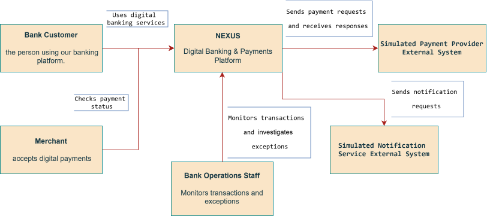

# NEXUS – System Context

## 1. Purpose

This document defines the system context of the NEXUS Digital Banking & Payments Platform.

It identifies the system boundary, primary users, external systems, and high-level interactions.

The System Context view follows the C4 modelling approach and addresses stakeholder concerns identified in `stakeholders-and-concerns.md`.

## 2. System of Interest

**System Name:** NEXUS Digital Banking & Payments Platform

**Description:** NEXUS is a fictional digital banking and payments platform that enables customers to manage accounts and wallets, initiate fund transfers, make merchant payments, and track transaction statuses.

The platform will use synthetic data and simulated integrations for educational and demonstration purposes.

## 3. System Boundary

### Inside NEXUS

The following capabilities are within the NEXUS system boundary:

- Customer profile management
- Account and wallet management
- Balance management
- Fund transfer initiation and processing
- Merchant payment processing
- Transaction status tracking
- Notification orchestration
- Audit logging and operational reporting

### Outside NEXUS

The following systems are external to NEXUS:

- Simulated external banking/payment provider
- Simulated notification delivery service

These external systems will be represented by mock integrations in the prototype.

## 4. Users and External Systems

| ID | Actor or System | Description | Interaction with NEXUS |
|---|---|---|---|
| EXT-01 | Bank Customer | Individual using digital banking services | Views balances, initiates transfers, makes payments, checks transaction status |
| EXT-02 | Merchant | Business accepting digital payments | Receives payment confirmations and checks payment status |
| EXT-03 | Bank Operations Staff | Personnel responsible for operational oversight | Reviews transactions, investigates exceptions, accesses reports |
| EXT-04 | Simulated Payment Provider | External mock banking or payment network | Receives simulated payment requests and returns responses |
| EXT-05 | Simulated Notification Service | External mock messaging service | Receives notification requests and simulates delivery outcomes |

## 5. High-Level Interactions

### Customer Banking

1. A customer accesses NEXUS.
2. The customer views account or wallet information.
3. NEXUS retrieves the relevant information and displays it.

### Fund Transfer

1. A customer initiates a fund transfer.
2. NEXUS validates the request.
3. NEXUS processes the simulated transfer.
4. Where applicable, NEXUS communicates with the simulated payment provider.
5. NEXUS records the transaction outcome and provides a status.

### Merchant Payment

1. A customer initiates a merchant payment.
2. NEXUS validates and processes the simulated payment.
3. The merchant can retrieve or receive the payment status.
4. NEXUS records the payment outcome.

### Notifications

1. NEXUS generates a notification request for a relevant event.
2. The simulated notification service receives the request.
3. The service returns a simulated delivery outcome.

## 6. Architecture Concerns Addressed

This context description primarily supports:

- CON-05: Interoperability
- CON-09: Usability

It also provides context for evaluating security, availability, performance, and data integrity in subsequent architecture views.

## 7. C4 System Context Diagram

The following diagram illustrates the NEXUS system boundary, external actors, external systems, and their high-level interactions with the platform.

*Figure 1: NEXUS C4 System Context Diagram*

[View editable diagram source](../diagrams/context/nexus-system-context.drawio)

## 8. Assumptions

- NEXUS is an educational prototype, not a production banking system.
- No real financial transactions will occur.
- All users and financial records are fictional.
- External integrations will be simulated.
- Detailed implementation decisions will be documented separately.

## 9. Status

Initial system context definition. Subject to refinement as requirements and architecture decisions evolve.